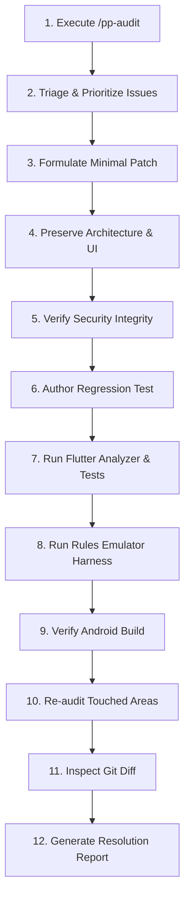

# ParchiPocket Systematic Bug Repair (`/pp-fix`)

This skill defines the controlled, disciplined repair workflow for ParchiPocket. It remediates confirmed defects and security vulnerabilities with minimal, targeted modifications accompanied by strict regression testing.

---

## 1. Safety, Security & Git Constraints

> [!CAUTION]
> Adhere strictly to these project safety rules during any repair operation:
> 1. **No Unapproved Firebase Production Changes**: Never deploy production Firebase rules or cloud configurations without explicit user permission.
> 2. **No Data Deletion or Tampering**: Never modify or delete production user data.
> 3. **No Credential Exposure**: Never hardcode or leak secrets, service account credentials, or API keys.
> 4. **No Test Neutralization**: Never disable, weaken, or comment out tests simply to pass validation.
> 5. **No Premature Git Operations**: Never commit or push changes without explicit user approval.
> 6. **Do Not Merge PR #5**: Pull Request #5 must remain in its current draft/feature state until authorized.
> 7. **Preserve Existing Artifacts**:
>    - Preserve modified unstaged changes in [test_rules.js](file:///c:/dev/parchipocket/test_rules.js).
>    - Preserve untracked file `release-assets/app-debug.apk` without overwriting or deleting it.

---

## 2. Standard 12-Step Repair Workflow

Follow these 12 steps in sequence for any repair task:



### Step 1: Run the Audit First
Execute the `/pp-audit` inspection to establish a verified baseline of all findings across the codebase and rules.

### Step 2: Prioritize Critical & High Issues
Group findings and address confirmed **Critical** and **High** severity issues first before addressing lower-priority tasks.

### Step 3: Implement Minimal, Targeted Fixes
Apply concise, highly scoped code edits directly resolving the bug root cause. Avoid wide-ranging architectural refactorings or style churn.

### Step 4: Preserve Architecture & Features
- Respect the central `AppState` architecture and separation between demo and cloud modes.
- Preserve existing screens, UI conventions, and the "Home & Family" daily expense flows.
- Keep legacy seller/vendor screens intact even while their entry points are paused.

### Step 5: Protect Firebase Security
Never relax or weaken Firestore security rules. Rules on `/users/{userId}/householdExpenses/{expenseId}` must always enforce owner isolation (`isOwner(userId)`) and immutability (`allow update, delete: if false;`).

### Step 6: Author Regression Tests
Every bug fix must be accompanied by an automated regression test:
- Unit/widget tests in `mobile/parchipocket_flutter/test/`.
- Security rule tests in [test_rules.js](file:///c:/dev/parchipocket/test_rules.js).

### Step 7: Run Flutter Static Analysis & Unit Tests
```powershell
cd mobile/parchipocket_flutter
flutter analyze
flutter test --reporter compact
```
All tests must pass with zero analyzer issues.

### Step 8: Run Isolated Firestore Rules Emulator Harness
Verify rules against the isolated demo project using Android Studio's bundled JBR:
```powershell
# From C:\dev\parchipocket
$env:JAVA_HOME = "C:\Program Files\Android\Android Studio\jbr"
$env:PATH = "$env:JAVA_HOME\bin;$env:PATH"
npx --yes firebase-tools@latest emulators:exec --only auth,firestore --project demo-parchipocket-phase4 "node test_rules.js"
```
Ensure all 73+ tests pass.

### Step 9: Verify Android Build (When Feasible)
When Android build or compilation changes are involved, verify build readiness:
```powershell
cd mobile/parchipocket_flutter
flutter build apk --debug
```

### Step 10: Re-audit Modified Areas
Conduct a focused review of the touched files to verify that no new security regressions, nullability flaws, or performance issues were introduced.

### Step 11: Inspect Complete Git Diff
Review the exact changes using `git diff` to ensure:
- Only intended files were modified.
- No debug statements, temporary scripts, or credentials were added.
- Existing changes in `test_rules.js` and `release-assets/` are maintained.

### Step 12: Produce Resolution Report
Document the work in a clean markdown report summarizing:
- Solved issues and root causes.
- Files modified and test additions.
- Exact test execution results.
- Unresolved or deferred items.
