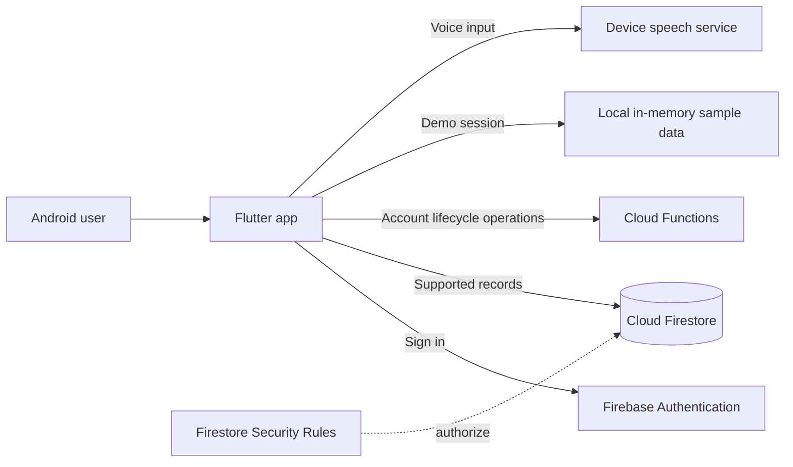

<p align="center">
  
</p>

<p align="center">
  <strong>Everyday spending, easier to track.</strong><br />
  Record household purchases, review your daily spending, and understand category-wise totals from one Android app.
</p>

<p align="center">
  <a href="https://github.com/rabit001/parchipocket/releases/tag/parchipocket-beta-v0.1.5-5"><strong>Download the signed Beta APK</strong></a>
  &nbsp;·&nbsp;
  <a href="docs/SETUP_GUIDE.md">Developer setup</a>
  &nbsp;·&nbsp;
  <a href="https://github.com/rabit001/parchipocket/issues">Report an issue</a>
</p>

<p align="center">
  <a href="https://github.com/rabit001/parchipocket/actions/workflows/backend-validation.yml"></a>
  
  
  
  
</p>

---

## About the project

**ParchiPocket** is a Flutter-based Android app focused on everyday **Home & Family spending**. It helps users record household purchases, keep a daily spending log, and review category-wise totals. Purchases can be entered manually or with voice assistance, with a review step before anything is saved.

The app uses **Firebase Authentication** and **Cloud Firestore** for supported signed-in experiences. A separate demo mode is available for exploring the app with sample data.

> **Project status:** ParchiPocket is currently distributed as a signed Beta APK through GitHub Releases. It is not a Play Store release and should not be treated as a production accounting, banking, or financial service.

## What you can do

| Feature | What it does |
| --- | --- |
| **Household purchase entry** | Add a purchase manually, review its details, and confirm before saving. |
| **Voice-assisted entry** | Speak one purchase at a time. The device speech service and local parsing prepare an entry for you to review. |
| **Daily Log** | Review saved household purchases and follow day-to-day spending. |
| **Spending insights** | See current-month totals and category-wise spending based on saved entries. |
| **Google Sign-In** | Sign in through Google and Firebase Authentication. |
| **Phone authentication** | Firebase Phone Auth is integrated; real SMS delivery depends on provider configuration, quotas, test-number settings, and applicable billing. |
| **Profile settings** | Edit the contact number shown in your profile. Saving a number does not verify ownership of that number. |
| **Profile photo** | Choose a custom photo stored privately on the current device. It does not sync to other devices. |
| **Receipt claims** | Use the existing QR/manual claim flow and access a read-only claimed receipt copy. |
| **Beta updater** | Check for a newer Android Beta, validate its metadata and SHA-256 checksum, then hand off to Android's package installer. |

Shop Owner and Street Vendor modules remain in the repository for compatibility and future development, but their role choices and main navigation are paused in the current app experience.

## How the app handles data

| Session type | Data behaviour |
| --- | --- |
| **Signed-in account** | Supported records are stored in Cloud Firestore and scoped to the authenticated Firebase user ID. |
| **Demo mode** | Uses local, in-memory sample data. It is not a cloud account or a persistent ledger, and demo activity must not read or write cloud account records. |
| **Custom profile photo** | Stored in private app storage on the current device; it is not uploaded or synchronised. |

This distinction matters: demo data disappearing after an app restart is expected, and a profile contact number is not the same as a verified phone-authentication credential.

## Latest signed Android Beta

<p>
  <strong>Version 0.1.5+5</strong><br />
  Package: <code>com.parchipocket.app.parchipocket</code>
</p>

- **Release notes and assets:** [ParchiPocket Beta 0.1.5+5](https://github.com/rabit001/parchipocket/releases/tag/parchipocket-beta-v0.1.5-5)
- **APK:** [Download parchipocket-release.apk](https://github.com/rabit001/parchipocket/releases/download/parchipocket-beta-v0.1.5-5/parchipocket-release.apk)
- **SHA-256 file:** [Download checksum](https://github.com/rabit001/parchipocket/releases/download/parchipocket-beta-v0.1.5-5/parchipocket-release.apk.sha256)

The in-app updater checks release metadata and verifies the APK checksum before opening Android's installer. Android requires the user to approve installation; updates are not installed silently. For the signing certificate fingerprint and full artifact details, see [Release Artifacts](docs/RELEASE_ARTIFACTS.md).

## Technology

| Layer | Technology |
| --- | --- |
| Android application | Flutter, Dart, and native Android integration |
| Authentication | Firebase Authentication and Google Sign-In |
| Cloud data | Cloud Firestore |
| Access control | Firestore Security Rules |
| Server-side operations | Firebase Cloud Functions (Node.js) |
| App integrity | Firebase App Check integration |
| Voice input | Device speech service through the repository-local `speech_to_text` package |
| CI and release automation | GitHub Actions |
| Verification | Flutter tests, static analysis, Firebase Emulator Suite, and Android emulator integration tests |

## Architecture at a glance



## Run the project locally

### Prerequisites

Use the same core toolchain as CI when possible:

- Flutter **3.47.9**
- Android Studio and Android SDK
- Java **21**
- Node.js **22** and npm for Functions and emulator tooling
- A configured Android emulator for local app testing

Check your environment:

```powershell
flutter --version
flutter doctor
java -version
node --version
npm --version
```

### Start the Android app

From the repository root:

```powershell
cd mobile/parchipocket_flutter
flutter pub get
flutter devices
flutter run
```

The Flutter project is the folder containing `pubspec.yaml`. Authenticated cloud features require the app's Firebase configuration to match the intended Firebase project. See the [Setup Guide](docs/SETUP_GUIDE.md) before changing Firebase configuration.

### Run tests and static analysis

From `mobile/parchipocket_flutter/`:

```powershell
flutter test --reporter compact
flutter analyze
```

### Run backend security harnesses

From the repository root, with Java and Node.js available:

```powershell
npx firebase-tools emulators:exec --only auth,firestore --project demo-parchipocket-phase4 "node test_rules.js && node test_deletion.js"
```

Use the `demo-parchipocket-phase4` emulator project for these tests. **Never point test harnesses at the production Firebase project.**

For the combined repository verification script on Windows:

```powershell
.\scripts\verify-backend.ps1
```

For Android emulator integration tests, Firebase setup, and troubleshooting, follow the [Developer Setup Guide](docs/SETUP_GUIDE.md) and [Backend Runbook](docs/BACKEND_RUNBOOK.md).

## Repository structure

```text
.
├── .github/                       # CI workflows, issue forms, and PR template
├── docs/                          # Product, architecture, setup, and release docs
├── functions/                     # Firebase Cloud Functions
├── mobile/
│   └── parchipocket_flutter/      # Flutter Android application
├── packages/
│   └── speech_to_text/            # Repository-local speech package
├── public/delete-account/         # Account-deletion portal source
├── scripts/                       # Local verification and packaging scripts
├── ParchiPocket_Brand_Assets/     # Brand artwork
├── firestore.rules                # Firestore authorization rules
├── firebase.json                  # Firebase CLI and emulator configuration
├── test_rules.js                  # Firestore rules test harness
└── test_deletion.js               # Account-deletion test harness
```

Inside the Flutter app:

- `lib/core/` — shared state, persistence, monitoring, and app services.
- `lib/features/` — authentication, customer experience, expenses, receipts, settings, updates, and retained seller modules.
- `lib/shared/` — theme and reusable widgets.
- `test/` — unit and widget tests.
- `integration_test/` — Firebase emulator-backed integration tests.
- `android/` — native Android project, launcher resources, and update-installer integration.

See [Repository Structure](docs/REPOSITORY_STRUCTURE.md) for the detailed source map.

## Project documentation

| Document | What you'll find |
| --- | --- |
| [Project Overview](docs/PROJECT_OVERVIEW.md) | Product scope, principles, and current direction |
| [Feature Status](docs/FEATURE_STATUS.md) | Implemented, paused, and planned capabilities |
| [Architecture](docs/ARCHITECTURE.md) | Client, Firebase, and backend structure |
| [Developer Setup](docs/SETUP_GUIDE.md) | Windows, Flutter, Android, and Firebase setup |
| [Backend Runbook](docs/BACKEND_RUNBOOK.md) | Emulator validation and safe backend operations |
| [Repository Structure](docs/REPOSITORY_STRUCTURE.md) | Detailed source tree |
| [Development Roadmap](docs/DEVELOPMENT_ROADMAP.md) | Remaining product work |
| [Release Artifacts](docs/RELEASE_ARTIFACTS.md) | APK details, checksums, and release process |
| [Contributing](CONTRIBUTING.md) | Branching, pull requests, and test expectations |
| [Security Policy](SECURITY.md) | How to report a vulnerability |

## Known limitations

ParchiPocket is still evolving. The following areas are not yet production-complete:

- Reliable offline queueing and conflict resolution.
- Cloud-synchronised profile photos.
- PDF receipt export and live nearby-shop discovery.
- Production thermal-printer validation.
- Push notifications.
- Complete data export, backup, retention, and recovery workflows.
- Play Store publication, privacy/compliance review, and broad real-device validation.

Speech recognition availability and accuracy, including Hindi/Hinglish recognition, depend on the Android device and its installed speech service. Always review recognised item details and amounts before saving.

## Security notes

- Firestore access is governed by the checked-in Security Rules and authenticated user identity.
- Demo mode must remain isolated from signed-in cloud data.
- Firebase Console settings, App Check enforcement, deployed rules, and deployed Cloud Functions must be verified independently; repository code alone cannot prove their live production state.
- Never commit signing keys, passwords, debug tokens, service-account files, or local environment files.
- Report suspected vulnerabilities privately using the process in [SECURITY.md](SECURITY.md).

## License

No open-source license is currently declared in this repository. Public visibility does not automatically grant permission to reuse, modify, or redistribute the code. A license should be selected by the maintainer before the project is offered for open-source reuse.

---

<p align="center">
  <strong>ParchiPocket</strong><br />
  Built and maintained by <a href="https://github.com/rabit001">Rabit Mansuri</a>
</p>
